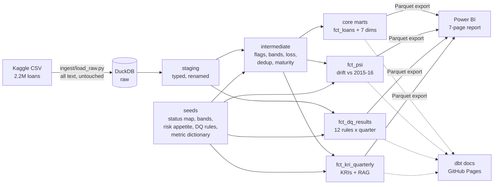

# Credit Risk Control Tower

**A governed credit-risk monitoring product: dbt pipeline + Power BI report, built on public lending data.**

One trusted view of portfolio health, early-warning KRIs, model population drift and data quality, with every number tested, documented and traceable from source to dashboard.

> Independent portfolio project on public data (LendingClub loans, 2014-2018). No employer, client or confidential data. Risk-appetite thresholds are illustrative.

[](https://github.com/ar-raj95/credit-risk-control-tower/actions/workflows/ci.yml)

**Demo video (2 min):** *add link* · **dbt docs and lineage:** *https://ar-raj95.github.io/credit-risk-control-tower* · **Report PDF:** `powerbi/report.pdf`

---

## 1. The problem

Risk teams going through transformation tend to hit the same four issues:

1. KRIs are calculated in several places with different definitions, so two reports disagree.
2. Data quality problems surface late, usually when a number looks wrong in front of a senior stakeholder.
3. Model inputs drift without anyone noticing until model performance drops.
4. Business users can't self-serve, so analysts become the bottleneck.

**This project's answer:** move every business rule out of the dashboard and into a version-controlled, tested pipeline. Define each metric once. Measure data quality and drift on every run. Publish the definitions where business users can read them.

## 2. Architecture



## 3. How it is governed

| Control | How it is implemented | Where to see it |
|---|---|---|
| One definition per metric | KRI logic lives in `int_loans_enriched` and `fct_kri_quarterly`; DAX only aggregates | `dbt/models/` |
| Business rules as reviewed config | Status mapping, FICO/DTI bands, risk appetite, DQ rules and metric dictionary are seed files, changed by pull request | `dbt/seeds/` |
| Bad data cannot reach the report | Tests run before marts build; a failing test skips everything downstream, so Power BI keeps the last good data | CI run log |
| Reconciliation | Singular tests check mart totals against staging (within 0.1%) and the KRI table against the loan fact | `dbt/tests/` |
| Stable interfaces | Enforced model contract on `fct_loans` (names, types, primary key) | `dbt/models/marts/core/_core.yml` |
| Logic is proven | Unit test on status flags, loss, bands and maturity with hand-built inputs | `dbt/models/intermediate/_int.yml` |
| Data quality measured, not hidden | 12 rules across completeness, validity, uniqueness and consistency run on staging, before cleaning | `fct_dq_results` |
| Model population drift | PSI per feature and quarter against the 2015-16 baseline, with bin-level drill-down | `fct_psi`, `fct_psi_bins` |
| Lineage to the dashboard | The Power BI report is declared as a dbt exposure | dbt docs lineage graph |
| Code quality | SQLFluff lint and full build on every pull request | `.github/workflows/ci.yml` |

**Example of a gate working:** if the source sends a loan status the business hasn't mapped (say, "Restructured"), the relationships test on staging fails, 37 downstream steps are skipped, and the report is not refreshed with unclassified loans. The fix is one reviewed line in `loan_status_map.csv`.

## 4. Quick start

Runs in about 5 minutes on synthetic data, no download or account needed. For a full walkthrough on Windows, see [docs/SETUP_VSCODE.md](docs/SETUP_VSCODE.md).

```bash
git clone https://github.com/YOUR-USERNAME/credit-risk-control-tower.git
cd credit-risk-control-tower
python -m venv .venv && source .venv/bin/activate   # Windows: .venv\Scripts\activate
pip install -r requirements.txt

python ingest/make_fixture.py                         # 5,000 synthetic loans with planted defects
python ingest/load_raw.py --input data/fixture.csv
cd dbt && dbt build                                   # expect 1 WARN: the planted bad DTI values
dbt docs generate && dbt docs serve                   # browse lineage and definitions
```

**With the real data:** download `accepted_2007_to_2018Q4.csv.gz` from [Kaggle (wordsforthewise/lending-club)](https://www.kaggle.com/datasets/wordsforthewise/lending-club) into `data/`, then `python ingest/load_raw.py --input data/accepted_2007_to_2018Q4.csv.gz` and `dbt build`. The Parquet files Power BI reads land in `data/marts/`. Connecting Power BI is covered in [`docs/POWERBI_GUIDE.md`](docs/POWERBI_GUIDE.md).

## 5. The report

| # | Page | Persona | Question it answers |
|---|---|---|---|
| 1 | Executive Summary | Head of Credit Risk | Are we inside risk appetite? |
| 2 | Composition and Concentration | Credit Risk Analyst | Where is exposure concentrated? |
| 3 | Vintage Performance | Credit Risk Analyst | Which origination quarters are deteriorating? |
| 4 | Segment Drill-down | Credit Risk Analyst | Which FICO x DTI pockets drive losses? |
| 5 | Population Stability | Model Risk | Is today's population still like the one the model was built on? |
| 6 | Data Quality Scorecard | Data Steward | Which rules fail, where, and is it getting worse? |
| 7 | Metric Dictionary | Any business user | What does this number mean and who owns it? |

*Screenshots: add one per page in `screenshots/` and embed them here.*

## 6. Product ownership

Run as a product, not a dashboard. See `docs/`:

| Artefact | Content |
|---|---|
| [Product vision](docs/01_product_vision.md) | Who it serves, why now, success measures, scope, principles |
| [Backlog](docs/02_backlog.md) | 5 epics, 12 stories with Given/When/Then criteria, MoSCoW and value/effort scoring, linked to evidence |
| [Release plan](docs/03_release_plan.md) | R1 to R3 with exit criteria and a definition of done |
| [DQ rulebook](docs/04_dq_rulebook.md) | Gates vs scorecard, 12 rules, severity and response, how to add a rule |
| [UAT and reconciliation](docs/05_uat_and_reconciliation.md) | Automated and manual test cases mapped to stories |
| [RAID log](docs/06_raid_log.md) | Risks, assumptions, issues and dependencies |
| [Decision log](docs/07_decision_log.md) | 10 design decisions with alternatives and reasons |
| [Power BI guide](docs/POWERBI_GUIDE.md) | Loading the marts, relationships, DAX, RLS |
| [VS Code setup guide](docs/SETUP_VSCODE.md) | Step by step from install to published repo, with troubleshooting |

Sample stories:

| ID | Story | Acceptance criteria | Priority |
|---|---|---|---|
| US-01 | As Head of Credit Risk, I want headline KRIs against risk appetite so I see breaches at a glance. | RAG per KRI; thresholds changed in one seed file, not DAX | Must |
| US-02 | As a Credit Analyst, I want default rate by grade, purpose and vintage so I can locate risk build-up. | Cross-filtering on all pages; totals reconcile to source within 0.1% (automated test) | Must |
| US-07 | As a Data Steward, I want unmapped or invalid source data to stop the refresh so wrong numbers never reach executives. | Build fails on unmapped status; downstream marts not rebuilt; failure visible in CI | Must |
| US-03 | As a Model Risk reviewer, I want PSI per feature by quarter so I see drift early. | Baseline 2015-16; standard bands from seed; drill to bin level | Should |
| US-05 | As a business user, I want metric definitions where I work so I don't need to ask an analyst. | Every metric in the dictionary; published in dbt docs and Page 7 | Should |
| US-06 | As a Regional Manager, I want to see only my region's data. | RLS by Census region; tested with View as role | Could |

## 7. Key findings

*Fill in after running on the real data. 3-5 quantified, reconciled insights, for example:*

1. *Which grade or purpose contributes the most loss relative to its share of exposure.*
2. *Which vintage deteriorated most among matured vintages, and which FICO x DTI pockets drive it.*
3. *Which features drifted most between 2015-16 and 2017-18, and whether that matches known pricing or policy changes.*
4. *Which DQ rules fail most and the likely upstream cause.*

## 8. Limitations and assumptions

- Public US peer-to-peer lending data used as a **proxy** for a retail lending book. Not representative of any institution.
- **Right-censoring:** vintages where under half the loans have reached term are flagged (`is_right_censored`). Their observed default rates are understated.
- **Loss** is gross principal loss on defaulted loans (funded amount minus principal received), excluding recoveries. It is not an accounting write-off or an IFRS 9 ECL.
- **Thresholds are illustrative.** In a real engagement they are agreed with the risk owner.
- **Synthetic fixture** values used in CI are random and carry no meaning. They exist to exercise the pipeline and its tests.

## 9. Repo structure

```
├── ingest/                 load_raw.py (raw landing), make_fixture.py (synthetic CI data)
├── dbt/
│   ├── models/staging/     typed source, no business logic
│   ├── models/intermediate/ business rules applied once, unit-tested
│   ├── models/marts/core/  fct_loans + dims, contract-enforced
│   ├── models/marts/monitoring/  KRIs, PSI, DQ results
│   ├── seeds/              reviewed business config
│   ├── macros/             PSI, quarter logic, Parquet export, generic tests
│   └── tests/              reconciliation tests
├── powerbi/                .pbip project (model + report) and PDF export
├── docs/                   Power BI guide, PO artefacts
├── screenshots/
└── .github/workflows/ci.yml
```

## 10. Roadmap

- [ ] R1: pipeline, CI, Pages 1-3
- [ ] R2: Pages 4-6
- [ ] R3: RLS, docs site, certified semantic model, scheduled refresh
- [ ] Next: cloud warehouse target (Snowflake), dbt v2 upgrade, observability package for test-result history, model performance monitoring (Gini, KS), ECL staging view

## About

Built by *[Your name]* · *[LinkedIn]*
